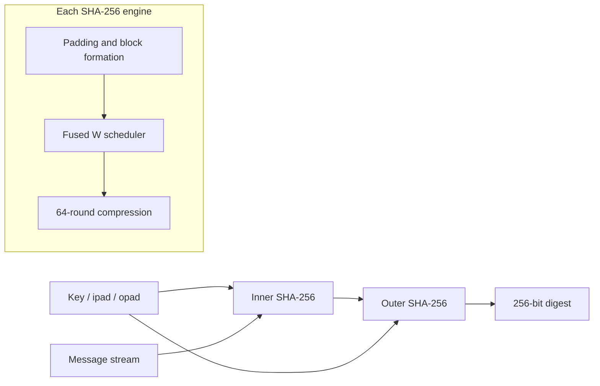

# FPGA HLS Operator Optimization

**SHA-256 / HMAC-SHA256, LZ4 compression, and complex fixed-point Cholesky on AMD Zynq-7020.**

[English](README.md) | [简体中文](README.zh-CN.md)


A hardware optimization project from the 2025 FPGA competition AMD track. Three workloads explore the same engineering problem: **reduce execution time by restructuring dataflow, memory access, and arithmetic while preserving correctness and staying within device resource limits**.

The implementation combines synthesizable C++, HLS streams, loop pipelining, array partitioning, and algorithm-specific microarchitectures. This repository contains the operators, their required library dependencies, test fixtures, portable Tcl entry points, and selected performance evidence.

## Highlights

- **SHA-256:** a fused 64-round message scheduler with a 16-word circular buffer; producer-side duplication of block metadata removes an extra dataflow task.
- **LZ4:** a four-bank dictionary, parallel candidate matching, and a restructured encoder state machine balance latency against the critical path.
- **Cholesky:** reciprocal square root with Newton-Raphson refinement, partitioned storage, and unrolled dot products for 3 × 3 complex fixed-point matrices.
- **Verification-driven design:** C simulation, RTL co-simulation, timing, and resource reports guide optimization decisions.

## Results

Historical measurements use **Vitis HLS 2024.2** and **xc7z020-clg484-1**. Execution time is the competition metric, `estimated clock period × measured execution cycles`; it is not a board-level throughput measurement.

| Operator | Baseline cycles | Optimized cycles | Estimated clock | Execution time | Improvement |
|---|---:|---:|---:|---:|---:|
| HMAC-SHA256 | 809 | **591** | 13.846 → 12.985 ns | 11.201 → **7.674 µs** | **1.46×** |
| LZ4 compression | 3,390 | **1,471** | 13.220 → 9.735 ns | 44.816 → **14.320 µs** | **3.13×** |
| Complex Cholesky | 4,919 | **1,287** | 6.276 → 6.299 ns | 30.872 → **8.107 µs** | **3.81×** |

Cholesky values are **total execution cycles for the eight-matrix test**, not single-matrix latency; the optimized co-simulation screenshot reports 160 cycles per transaction. SHA-256 uses the later November 2 result; the written report describes an earlier 614-cycle iteration.

[Measurement details and original evidence →](docs/results.md)

## Architecture

### SHA-256 / HMAC



`preProcessing` publishes two independent block-count/end-flag streams directly to the scheduler and digest stages. A fully partitioned 16-word ring stores the message schedule, and the round function uses a balanced addition tree. FIFO depths and BRAM/LUTRAM bindings decouple the stages.

### LZ4 compression

```text
Input bytes → banked dictionary + match search → best-match filter
            → match booster → literal/offset/length encoder → compressed stream
```

Low hash bits select one of four dictionary banks. Unrolled byte comparisons produce a match mask; prefix continuity determines match length. The encoder uses explicit states and a two-cycle pipeline target where a shorter critical path improves total execution time.

### Complex Cholesky

The kernel factors a Hermitian positive-definite matrix into triangular factors. The fixed-point path initializes a reciprocal square root, applies one Newton-Raphson refinement, and obtains the diagonal through multiplication. Partitioned triangular storage supplies parallel accesses for unrolled inner products. Tests use `hls::x_complex<ap_fixed<16, 1, AP_RND_CONV>>`.

## Quick start

Install **AMD Vitis HLS 2024.2** with Zynq-7000 device support and open a terminal with the tool environment configured. The solver also uses toolchain-supplied headers such as `utils/x_hls_traits.h` and `utils/std_complex_utils.h`; a standard desktop C++ compiler alone cannot build these kernels.

```bash
git clone https://github.com/wenjiandely/fpga-hls-operator-optimization.git
cd fpga-hls-operator-optimization

# Run at repository root. Operators: sha256, lz4, cholesky.
# Stages: csim, csynth, cosim.
vitis_hls -f scripts/run_hls.tcl -tclargs sha256 cosim
vitis_hls -f scripts/run_hls.tcl -tclargs lz4 cosim
vitis_hls -f scripts/run_hls.tcl -tclargs cholesky cosim
```

`cosim` runs C simulation, synthesis, and Verilog co-simulation. Generated projects go to `build/<operator>/`. Target clock periods are 15 / 11 / 7 ns respectively, with 10% clock uncertainty. A third argument optionally overrides the period:

```bash
vitis_hls -f scripts/run_hls.tcl -tclargs sha256 csynth 15.0
```

Included inputs cover two HMAC vectors, an LZ4 text sample, and eight complex matrices. C/RTL equivalence checks hardware against the C model. The LZ4 helper additionally checks lossless decoding of the emitted raw block:

```bash
python scripts/check_lz4.py data_compression/L1/tests/lz4_compress/sample.txt build/lz4/sample.txt.encoded
```

The LZ4 and Cholesky optimized headers are restored from the supplied report's complete source listings. Results are historical; these restored headers and the portable build entry point have not been re-synthesized in this publication environment.

## Repository layout

```text
security/          SHA-256/HMAC headers and test vectors
data_compression/  LZ4 pipeline, dependencies, and sample input
solver/            Cholesky kernel, host test, and matrices
scripts/           HLS entry point and lossless-compression checker
reports/           Final SHA-256 simulation and synthesis evidence
docs/              Measurements and selected report figures
```

## Acknowledgements and license

Built on [AMD Vitis Libraries](https://github.com/Xilinx/Vitis_Libraries) and the competition test framework. Upstream copyright and Apache-2.0 notices are preserved. Distributed under [Apache-2.0](LICENSE); attribution and source provenance are recorded in [NOTICE](NOTICE).
