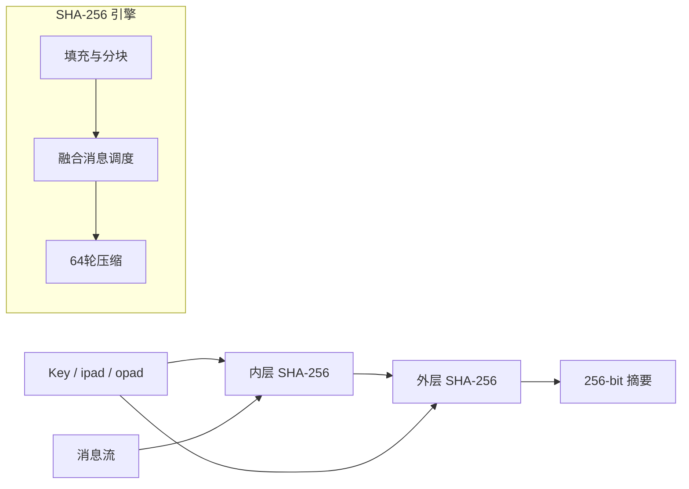

# FPGA HLS 算子优化

**面向 AMD Zynq-7020 的 SHA-256 / HMAC-SHA256、LZ4 压缩与复数定点 Cholesky 硬件优化。**

[English](README.md) | [简体中文](README.zh-CN.md)


本项目来自 2025 年 FPGA 竞赛 AMD 命题式赛道，针对密码学、数据压缩和矩阵分解三类负载，通过**数据流重构、存储分区和算术单元优化降低执行时间**，结合功能仿真、时序与资源报告开展验证。

工程采用可综合 C++，围绕 `hls::stream`、流水线、循环融合、数组分区和定点运算进行微架构设计。仓库保留核心算子、必要库依赖、测试数据、统一构建脚本与精简的性能依据。

## 项目亮点

- **SHA-256：**将消息调度融合为连续的 64 轮流水线，以 16 字循环缓冲区维护 W 序列；在生产端直接复制块计数与结束标志，减少任务边界。
- **LZ4：**采用四银行字典、并行候选匹配和编码状态机重构，综合权衡周期数与关键路径。
- **Cholesky：**通过倒数平方根和一次牛顿迭代替代高延迟运算，结合中间数组完全分区与内积展开，加速 3 × 3 复数定点矩阵分解。
- **验证闭环：**利用 C 仿真、RTL 协同仿真、时序与资源报告评估架构调整。

## 性能结果

历史测试环境为 **Vitis HLS 2024.2 / xc7z020-clg484-1**。执行时间采用竞赛指标 `估计时钟周期 × 实测执行周期数`，不等同于上板吞吐率。

| 算子 | 基线周期数 | 优化后周期数 | 估计时钟周期 | 执行时间 | 提升 |
|---|---:|---:|---:|---:|---:|
| HMAC-SHA256 | 809 | **591** | 13.846 → 12.985 ns | 11.201 → **7.674 µs** | **1.46 倍** |
| LZ4 压缩 | 3,390 | **1,471** | 13.220 → 9.735 ns | 44.816 → **14.320 µs** | **3.13 倍** |
| 复数 Cholesky | 4,919 | **1,287** | 6.276 → 6.299 ns | 30.872 → **8.107 µs** | **3.81 倍** |

Cholesky 的数值是**八个矩阵测试的总执行周期数**，不是单矩阵延迟；优化后的协同仿真截图中，每次事务延迟为 160 周期。SHA-256 采用 11 月 2 日的最新结果，书面报告保留的是较早的 614 周期版本。

[查看指标口径与原始依据 →](docs/results.md)

## 系统架构

### SHA-256 / HMAC



`preProcessing` 直接向消息调度和压缩模块分别发送块数量与结束标志，保持流的单生产者、单消费者关系。完全分区的 16 字循环缓冲区生成 W 序列，平衡加法树缩短轮函数组合路径，FIFO 深度与 BRAM/LUTRAM 绑定用于解耦各流水阶段。

### LZ4 压缩

```text
输入字节 → 分银行字典与匹配搜索 → 最佳匹配过滤 → 匹配扩展
         → 字面量/偏移/长度编码 → 压缩字节流
```

哈希低位决定字典银行，字节比较完全展开后生成匹配掩码，通过前缀连续性计算匹配长度。编码器使用显式状态机，在关键路径较长的部分采用两周期流水目标，以改善总执行时间。

### 复数 Cholesky

对 Hermitian 正定矩阵执行三角分解。定点路径生成倒数平方根初值后进行一次牛顿迭代，通过乘法计算对角元素；三角矩阵中间存储完全分区，为展开的内积运算提供并行访存。测试类型为 `hls::x_complex<ap_fixed<16, 1, AP_RND_CONV>>`。

## 快速开始

安装 **AMD Vitis HLS 2024.2** 及 Zynq-7000 器件支持，在已配置工具环境的终端中运行。Solver 还依赖工具链自带的 `utils/x_hls_traits.h`、`utils/std_complex_utils.h` 等头文件，普通桌面 C++ 编译器不能单独构建这些内核。

```bash
git clone https://github.com/wenjiandely/fpga-hls-operator-optimization.git
cd fpga-hls-operator-optimization

# 在仓库根目录运行。算子可选 sha256 / lz4 / cholesky。
# 阶段可选 csim / csynth / cosim。
vitis_hls -f scripts/run_hls.tcl -tclargs sha256 cosim
vitis_hls -f scripts/run_hls.tcl -tclargs lz4 cosim
vitis_hls -f scripts/run_hls.tcl -tclargs cholesky cosim
```

`cosim` 依次执行 C 仿真、综合和 Verilog 协同仿真，输出位于 `build/<operator>/`。三个算子的目标时钟分别为 15 / 11 / 7 ns，时钟不确定度为 10%。第三个参数可覆盖时钟周期：

```bash
vitis_hls -f scripts/run_hls.tcl -tclargs sha256 csynth 15.0
```

仓库内含两个 HMAC 向量、LZ4 文本样本和八组复数矩阵。C/RTL 协同仿真检查硬件与 C 模型一致性；LZ4 还可用以下脚本检查输出能否无损解压：

```bash
python scripts/check_lz4.py data_compression/L1/tests/lz4_compress/sample.txt build/lz4/sample.txt.encoded
```

LZ4 和 Cholesky 优化头文件根据所提供设计报告的完整代码附录恢复。性能表引用历史结果，本次整理环境未重新运行这些源码及便携构建入口的 HLS 综合。

## 目录结构

```text
security/          SHA-256 / HMAC 头文件与测试向量
data_compression/  LZ4 流水线、依赖和测试输入
solver/            Cholesky 内核、测试程序与矩阵
scripts/           统一 HLS 入口与无损压缩检查
reports/           SHA-256 最终仿真与综合依据
docs/              性能口径和精选报告图
```

## 致谢与许可

项目基于 [AMD Vitis Libraries](https://github.com/Xilinx/Vitis_Libraries) 及竞赛测试框架，保留上游版权和 Apache-2.0 声明。仓库采用 [Apache-2.0](LICENSE)，来源及修改说明见 [NOTICE](NOTICE)。
