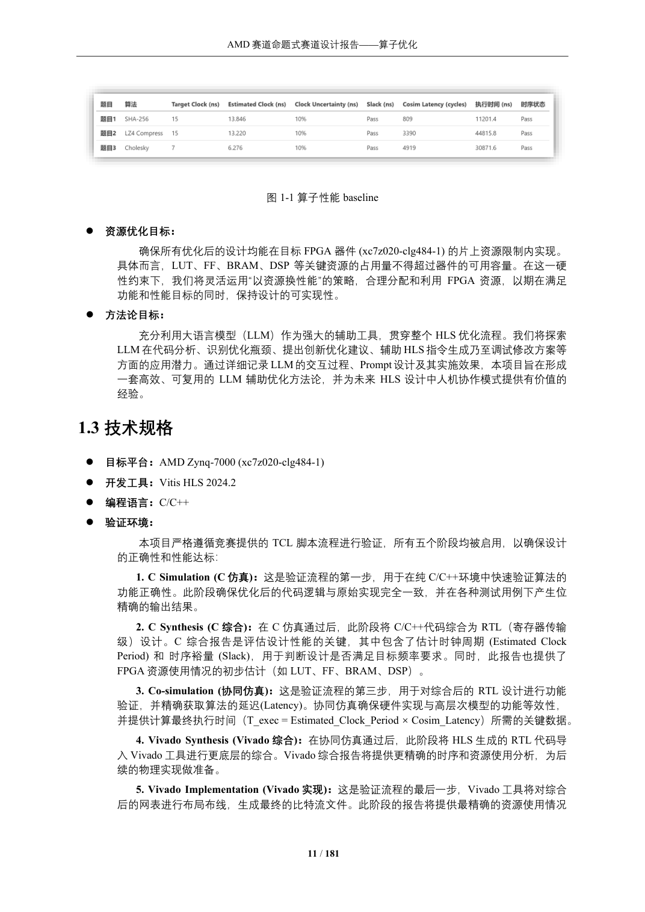
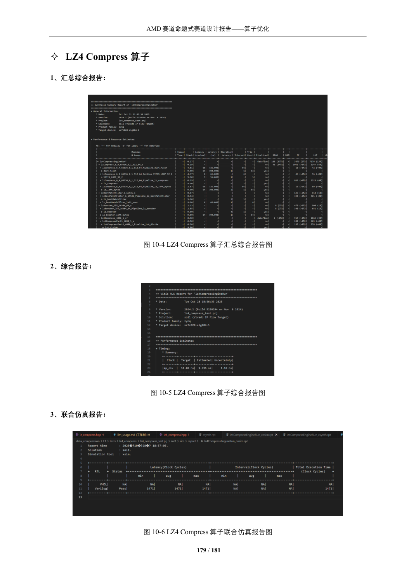
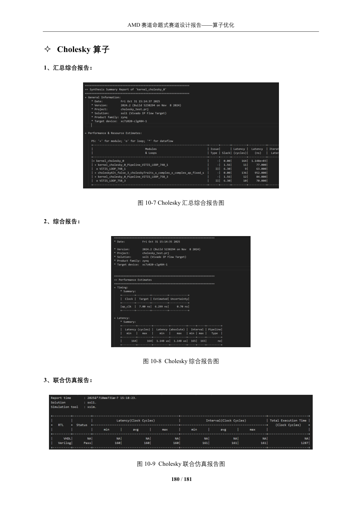

# Results / 性能结果

All measurements below are historical competition evidence. 本页区分历史实测、报告口径与本次整理检查。

## Measurement method / 指标口径

The competition metric is estimated clock period × execution cycles. This metric uses a synthesis estimate; it is not routed clock frequency or measured board throughput. 比较时采用相同测试，不能将多个事务的总执行周期误称为单次延迟。

| Operator | Baseline ns | Optimized ns | Speedup | Time reduction |
|---|---:|---:|---:|---:|
| hmac-sha256 | 11201.414 | 7674.135 | 1.460x | 31.49% |
| lz4 | 44815.800 | 14320.185 | 3.130x | 68.05% |
| cholesky | 30871.644 | 8106.813 | 3.808x | 73.74% |

## Evidence / 原始依据

- **Baseline:** the report's page 11 table gives SHA-256 809 cycles / 13.846 ns, LZ4 3390 / 13.220 ns, and Cholesky total 4919 / 6.276 ns. The SHA clock differs from a later prose section; this repository consistently uses the baseline table. 统一采用原报告基线表，不混用文中另一处时钟数值。
- **SHA-256:** November 2 reports record C simulation PASS (two vectors), Verilog co-simulation Pass at 591 cycles, estimated clock 12.985 ns, and a 15 ns target with 1.50 ns uncertainty. Final resource estimate: 64 BRAM_18K, 0 DSP, 12,504 FF, 14,165 LUT. 采用最终独立报告，未混入书面报告的 614 周期中间版本。
- **LZ4:** page 179 contains the 9.735 ns estimate and Verilog Pass at 1471 cycles. The written report gives an 11 ns target. Its code appendix contains the four-bank dictionary and restructured encoder.
- **Cholesky:** page 180 records per-transaction latency 160 cycles, interval 161 cycles, and **total execution 1287 cycles** for the eight-matrix test. The report's baseline total is 4919. The 6.299 ns estimate and 7 ns target are shown separately. 1287 不是单次矩阵分解延迟，也不是吞吐间隔。

LZ4 and Cholesky source was restored from the report appendix because the loose archive contained earlier headers. Their historic report figures are preserved; the restored code has not been re-synthesized here. 编译入口为整理时新增，实际时序与资源请以本地重新综合结果为准。

## Baseline table / 基线表

## LZ4 synthesis and co-simulation / LZ4 综合与协同仿真

## Cholesky synthesis and co-simulation / Cholesky 综合与协同仿真

